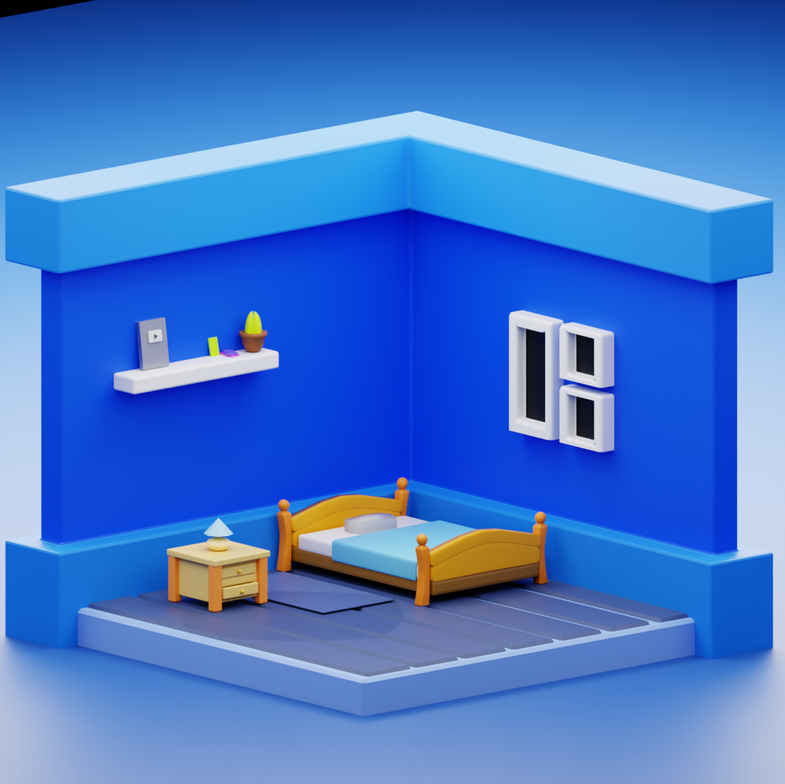
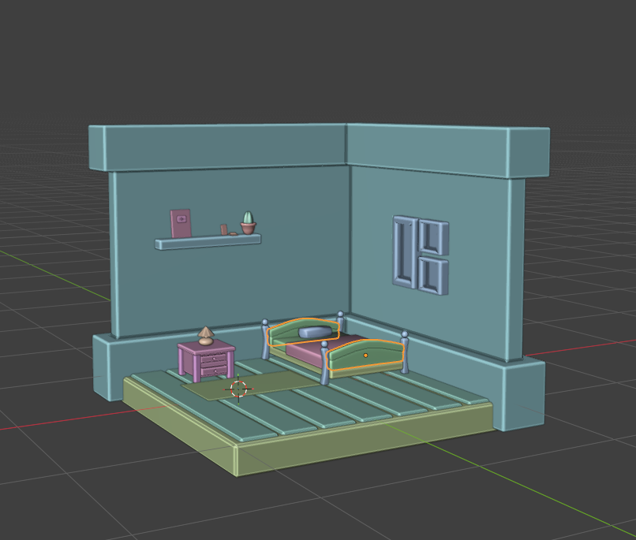

# 🛏️ Isometric Room — Blender 3D Project

<p align="center">
  
</p>

<p align="center">
  
  
  
  
</p>

---

## 📖 About The Project

A fully hand-modeled **isometric bedroom scene** created in Blender, featuring a stylized low-poly / cartoon aesthetic. The scene showcases a cozy bedroom with carefully crafted furniture, decorative props, and vibrant blue-toned lighting rendered with Cycles.

This project was built as a practice exercise in **isometric 3D scene composition**, low-poly modeling, material shading, and lighting setup inside Blender.

---

## 🖼️ Gallery

| Final Render | Solid Viewport |
|:---:|:---:|
|  |  |

---

## ✨ Features

- 🛏️ **Wooden bed** with stylized frame and cyan-blue bedsheet + pillow
- 🪴 **Wall shelf** with decorative props — a YouTube plaque, a succulent plant, and colorful books
- 🪟 **Window** with clean white frame mounted on the side wall
- 💡 **Nightstand** with a small table lamp
- 🏠 **L-shaped isometric room** with blue walls and tiled floor
- 🎨 **Bright cartoon-style materials** using Principled BSDF shading
- 💡 **Soft area lighting** setup for a clean, vibrant render

---

## 🛠️ Built With

| Tool | Purpose |
|------|---------|
| [Blender](https://www.blender.org/) | 3D modeling, shading, rendering |
| Cycles Render Engine | Photorealistic ray-traced rendering |
| Principled BSDF | PBR material shading |

---

## 📁 Project Structure

```
IsometricRoom Project/
│
├── Untitled.blend          # Main Blender project file
├── images/
│   ├── Render.png          # Final Cycles render output
│   └── SolideViex.png      # Solid viewport preview
└── README.md               # This file
```

---

## 🚀 Getting Started

### Prerequisites

- [Blender](https://www.blender.org/download/) **4.x** or later (compatible with 3.x+)

### Opening the Project

1. **Clone or download** this repository:
   ```bash
   git clone https://github.com/your-username/isometric-room.git
   ```

2. **Open Blender** and go to `File → Open`

3. Navigate to the project folder and open **`Untitled.blend`**

4. To render the scene, press **`F12`** or go to `Render → Render Image`

> **Tip:** Make sure to set the render engine to **Cycles** for the best result, or switch to **EEVEE** for a faster preview.

---

## ⚙️ Render Settings

| Setting | Value |
|---------|-------|
| Render Engine | Cycles |
| Samples | 128+ recommended |
| Resolution | 1080 × 1080 px |
| Color Space | Filmic |
| Camera | Orthographic (Isometric angle) |

---

## 🎓 What I Learned

- Modeling stylized low-poly furniture from scratch
- Setting up an isometric orthographic camera in Blender
- Working with Principled BSDF materials for a cartoon look
- Composing a scene with balanced lighting using area lights
- Organizing objects and collections inside Blender's outliner

---

## 📄 License

This project is open source and available under the [MIT License](LICENSE).

---

## 🙋‍♂️ Author

Made with ❤️ and Blender.

> *Feel free to fork, use, or get inspired by this project!*
